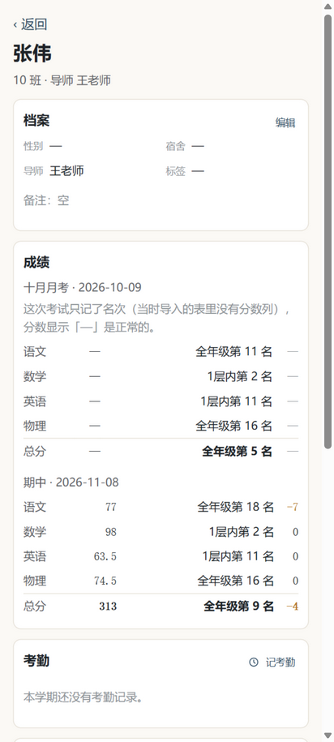

# 子衿

> 青青子衿，悠悠我心。 —— 《诗经·郑风·子衿》

一个**手机优先、本地优先、无需登录**的中学班主任 / 导师工作台（安卓）。

考完试把 Excel 成绩表导进来 → 在 33 个孩子里看见你分包的那 16 个 →
课间三十秒记一笔 → 周五自动生成交给学校的周工作手册。
**数据只存在手机本机：无账号、无云端、无埋点、零联网权限。**

<p align="center">
  
  
  
</p>

---

## 为什么做它

教务系统管的是「班级」，班主任惦记的是「那几十个具体的人」。
电子表格能存成绩，但记不住谁这周还没聊过、生成不了周五要交的登记表、
换台手机就束手无策。子衿把这三件事做成一个不联网的小应用。

## 功能

- **成绩导入**：xlsx / csv，支持多工作表、多行合并表头、两次考试同表（次别 1/2）、
  分层与导师列；列自动识别 + **人工确认页**（带表内数据样例）；重复导入同一次考试
  会刷新数据而不是翻倍
- **微信直通**：聊天里收到的成绩表「用其他应用打开 → 子衿」直接进导入确认
- **学生档案**：分包导师、宿舍、标签、备注；按性别 / 宿舍 / 标签筛选、按最近沟通排序
- **记录**：沟通 / 谈心 / 家访 / 约谈，三十秒一条，可改可删，跟进自动生成待办；
  支持多选学生（家长会场景）
- **考勤与作业**：全班名单平铺登记，未交次数与「连续 3 次没交」自动提醒
- **待办**：今日 / 本周 / 逾期顺延，完成可撤销
- **周工作手册**：按周自动生成登记表（沟通/谈心/家访次数、考勤、作业、最近成绩带池标签），
  导出 Excel / A4 页面 / 直接打印，下周重点自动带出
- **成绩分析**：各科班均、总分前三、每生与班均差、名次浮动（同池才可比）、总分趋势
- **数据安全**：每日自动快照（留 7 天）、一键备份 / 恢复 JSON

### 名次与排名池

不同科目的名次来自不同的池（分层池 / 全年级池 / 班内池），**跨池比较没有意义**。
子衿的每一条名次都带池标签（「1层内第 2 名」「全年级第 9 名」），池内名次做单调性校验。
详见 [docs/design-data.md](docs/design-data.md)。

## 安装

- 从 [Releases](../../releases) 下载签名 APK 安装（允许「未知来源」一次）
- 系统要求：Android 6.0+（自适应图标需 Android 8+）
- 第一次打开：按「三步开始使用」引导，导入一份 Excel 成绩表即可开始

## 隐私与数据

- **零联网权限、零第三方依赖服务、零埋点**：应用不申请 INTERNET 权限，
  数据只存在设备本机的 IndexedDB
- 内置学生数据**全部虚构**（见 [reference/samples](reference/samples)）；
  仓库不接受任何真实学生数据——判断法：能用 Ctrl+F 搜到一个真实人名就不许提交
- 备份与恢复：导出完整 JSON（建议每周一次，发到微信文件传输助手留存）；
  每日自动快照保留 7 天
- 合规提示：未成年人成绩与家校沟通记录属于敏感个人信息，请在学校知情的前提下、
  以职务用途为限使用；换班 / 离职时请清空数据（「我的 → 数据 → 清空全部数据」）

## 开发

```bash
npm install
npm run dev          # 浏览器开发，http://localhost:5173
npm test             # 单测（135 个）
npm run build        # 产出 dist/
npx cap sync android # 同步到安卓工程
cd android && ./gradlew assembleDebug   # 调试 APK
```

**架构铁律**：`src/domain/` 是纯函数层（成绩计算、排名池、导入管线四段
detect → map → confirm → commit），不出现 React / DOM / window；
`src/ui/` 只调 domain；`src/storage/` 是 IndexedDB 封装。纯函数才能被
单测覆盖，能被单测覆盖才能被自动化验证。

- 界面规范：[docs/design-ui.md](docs/design-ui.md)
- 数据模型与排名池：[docs/design-data.md](docs/design-data.md)
- 需求对照与排期：[docs/teacher-需求对照.md](docs/teacher-需求对照.md)
- 给老师的上手说明：[docs/使用说明.md](docs/使用说明.md)
- 开发日志（逐阶段记录与偏差）：[docs/handoff-full.md](docs/handoff-full.md)

安全与数据政策见 [SECURITY.md](SECURITY.md)。

## 协议

[MIT](LICENSE)
