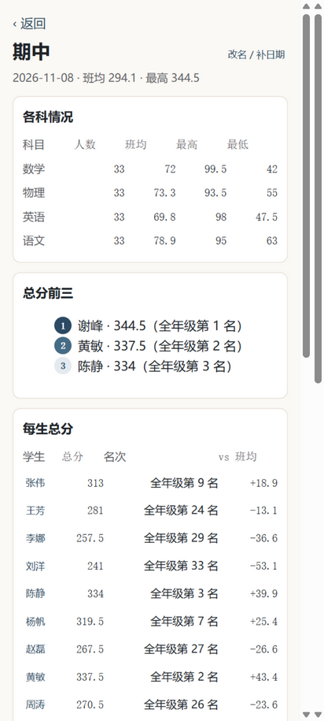

# 子衿

面向中学班主任与导师的本地工作台（安卓）。成绩导入、沟通记录、考勤作业、
周工作手册，全部数据保存在手机本机；应用不联网、无账号、不上传学生数据。

  
  
  

名称取自《诗经·郑风·子衿》：惦记的不是「班级」，是那几十个具体的人。

## 安装

从 [Releases](../../releases) 下载 APK 安装，系统提示「未知来源应用」时选择允许。
需要 Android 6.0 以上。

## 使用

**导入成绩表。** 首次打开后，点底部中间的 ＋ 键 → 「导入成绩表」，选择 Excel 或
CSV 文件；微信、QQ 里收到的表格文件也可以直接选「用其他应用打开 → 子衿」。
确认页列出每一列的识别结果，并以表内数据作样例，核对后给考试命名并确认。
随后在「我的 → 分包」中选择自己的名字，列表默认只显示分包学生。

**记一笔。** 今日页提供沟通 / 谈心 / 家访 / 其他四个入口，选学生、写内容、保存。
保存后弹层不关闭，可连续记录；多选模式支持一次记给多人。跟进字段自动生成待办。

**考勤与作业。** ＋ 键 → 「记考勤」逐人登记迟到 / 早退 / 病假 / 事假 / 旷课 / 离校；
「作业登记」全班名单平铺，点按切换交 / 未交 / 迟交 / 补交 / 免交。
未交次数与连续未交情况汇总到学生详情。

**考完试。** 将新成绩表以同一考试名再次导入，分数刷新、不产生重复。

**每周五。** 「我的 → 周工作手册」自动生成本周登记表与下周重点，
导出 Excel、A4 页面或直接打印。

**备份。** 「我的 → 导出备份 JSON」，通过分享面板发送到微信文件传输助手或保存本地；
每日自动快照保留 7 天，换手机用「恢复备份」迁移。

## 已知边界

- 一个软件一份名单：多位导师各记各的，数据暂不互通。
- 名次分池显示（几层内 / 全年级 / 班内），不同科目的名次不能直接比大小。
- 表格格式无法识别时，提 [Issue](../../issues) 并附列名（不含真实学生数据）。

## 构建

Node 18+ 与 Android Studio。`npm install` → `npm run dev` 在浏览器调试，
`npm test` 运行 135 个测试，`npm run build && npx cap sync android` 后
`cd android && ./gradlew assembleDebug` 出 APK。
数据模型见 [docs/design-data.md](docs/design-data.md)，上手说明见
[docs/使用说明.md](docs/使用说明.md)。

## 协议

[MIT](LICENSE)
