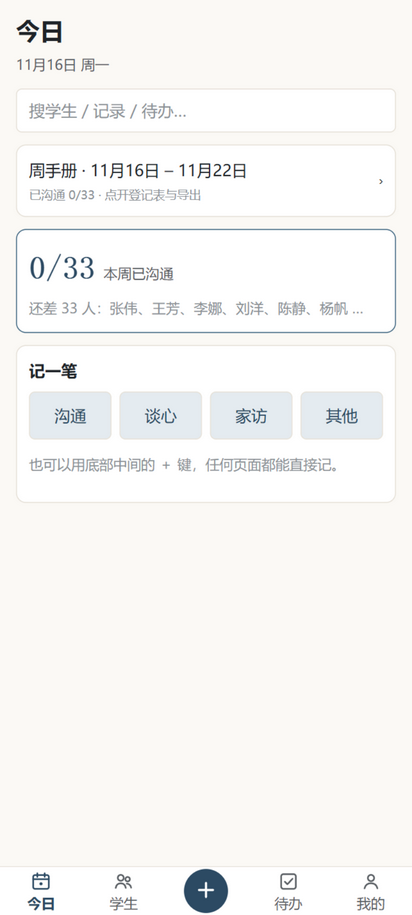
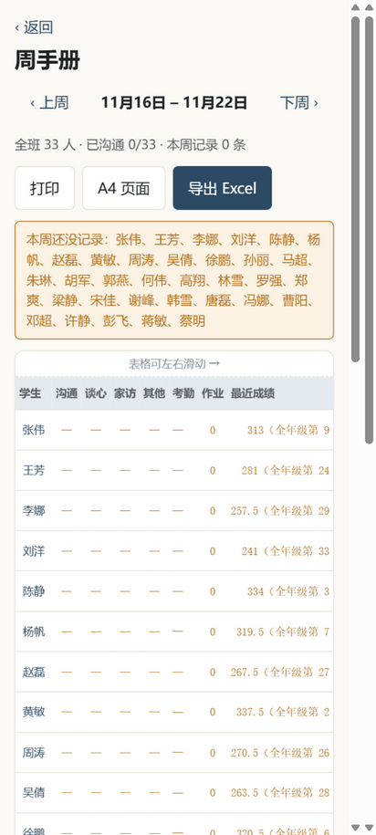

# 子衿

给中学班主任和导师用的记账小工具。装在安卓手机上，不联网、不用注册，
学生名单、成绩、沟通记录都只存在手机里，换手机靠导出的备份文件搬。

  
  
  

## 怎么装

到 [Releases](../../releases) 下载 APK 安装，系统提示"未知来源应用"时允许一次。
需要 Android 6.0 以上。

## 怎么用

**第一次打开**：软件是空的，先导入一份成绩表（Excel .xlsx）。
点底部中间的 ＋ → 导入成绩表；微信里收到的表格文件也可以直接选
"用其他应用打开 → 子衿"。导入前它会列出每一列认成了什么（姓名、分数、名次……），
核对一下再确认。然后到"我的 → 分包"里选自己的名字，列表就只看你分包的学生。

**平时**：聊完一个学生随手记一笔（沟通/谈心/家访，或者用待办提醒自己回访）。
作业和考勤可以按全班一起点。

**考完试**：把新的成绩表再导一次。同名考试会刷新数据，不会越导越多。

**周五**：打开周手册，每人一行的登记表已经生成好了，导出 Excel 交上去，
或者直接打印，下周要做的事会自动带出来。

**备份**：数据只在你手机上，丢了就没了。"我的 → 导出备份 JSON"，
建议每周发到微信文件传输助手存一份。换手机时在新手机上"恢复备份"选这个文件。

## 几句实话

一个软件一份名单：两个导师各记各的，数据暂时不互通。
名次分池显示（几层内 / 全年级），不同科目的名次不能直接比大小。
你们学校的表格格式认不出来？提个 [Issue](../../issues)，把列名贴上（别贴真实学生数据）。

## 自己构建

Node 18+ 和 Android Studio。`npm install` → `npm run dev` 在浏览器里调试，
`npm test` 跑测试，`npm run build && npx cap sync android` 之后
`cd android && ./gradlew assembleDebug` 出 APK。
架构和数据模型见 `docs/`，给老师的上手说明在 `docs/使用说明.md`。

## 协议

[MIT](LICENSE)
